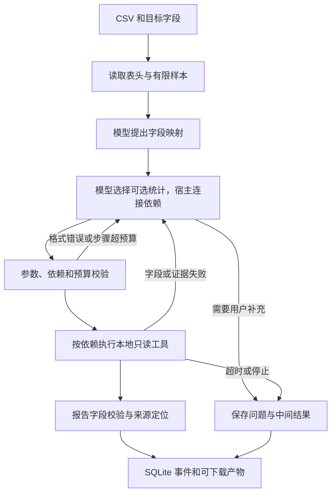

# Skillinter

本轮审查请从 [当前状态与已验证范围](docs/review-status.md) 开始，再读 [DeepSeek 单 Agent / Worker 三轮实测](docs/evidence/repro-audit-20261110/README.md)。

Skillinter 是面向科研和工程项目的任务工作台。用户在会话里提供目标、材料和权限，工作台记录执行路径、来源与产物，并支持从对话创建、验证和发布可复用技能。技能图谱使用 my-skill-library 的平面／球体界面，浏览 SIH 已安装的技能，也可定位本次实际执行的步骤及依赖。

项目主线是“任务发现方法 → 条件与关系约束执行 → 结果留证 → 经验隔离为候选 → 冻结对照 → 审核后版本复用”。各页面的作用、当前能力与后续核心工作见 [技能网络闭环](docs/skill-network.md)。

技能图谱选择节点后，可在详情下方的「身份与执行关系」声明依赖、互补或替代。依赖将影响下一轮的真实技能执行顺序，互补和替代不自动变成顺序；旧的浏览关联保持原语义。同名技能保留独立身份，原目录身份与项目覆盖均须明确绑定。每轮冻结版本和关系，回复中的技能链可查看原快照，后续编辑不回写历史。见 [阶段 A 的迁移、接口与验收](docs/skill-registry.md) 及 [总体架构](docs/architecture-roadmap.md)。

### 从经验到新版本

在完成的回复中点击「改进这个技能」或「保存为技能」，根据实际回执和纠正起草方法，并准备至少两个自包含用例。选择「保存为待验证候选」，草案会隔离保存到「技能中心 → 候选改进」，刷新不丢失，也不会进入主聊天的可用技能。

候选验证冻结原版本、草案和测试集，保留原版本回归用例，交替两组执行先后，逐对保存真实文本响应、检查、时延与用量。自动判据支持“包含：”与“不包含：”；其他判据保持待人工核验。只有全部通过、无回退且测出新增通过时才提供审核发布。平局、失败、截断、中断或模型变化均保留原版本；正式版本或验证实现变化须重新验证。发布后由下一轮聊天加载新版本，版本页保留候选验证入口。

这是文本用例范围的验证，不执行工具，也不证明通用学习收益或部署排序提升。手动维护仍可通过「手动审核发布」保存，版本页会标明未关联候选验证记录。[接口与结果定义](docs/skill-candidates.md)

### 实际产物验收

技能中心「创建 / 改进 → 实际产物验收」可声明产物路径、文本或 JSON 条件及须保持不变的输入。SIH 在本轮操作前冻结契约和原始文件指纹，`verify_skill_output` 重读实际产物，技能结束及任务结束时再次检查。不满足或无法确认时不能将该技能标为已应用；事后补条件不能追认通过。技能链显示逐项结果和文件指纹，失败、修复与重验记录可以下载，提炼经验时也会带入来源。[完整规则与示例](docs/skill-delivery.md)

### 原技能与候选的实际任务对照

在「候选改进 → 实际任务对照」中提供至少两个自包含任务、测试材料和产物判据。先冻结，再显式开始：两组各用独立临时目录、相同模型和预算，宿主检查真实产物，结果、耗时、用量、轨迹和下载文件并排显示。停止保留部分组，重启不自动重发模型请求。平局、回退和证据不足分别记录，原项目和正式技能不会因此更新。[执行边界与接口](docs/skill-execution.md)

### 主聊天中的任务计划

输入框模型选择旁的魔法棒按钮可优化当前草稿。使用当前选择的模型、最近两轮对话摘要和附件名称整理任务，展示可编辑的优化结果与待补充信息。选择「替换到输入框」后再发送，取消保留原稿。多步骤任务会建议列出并更新计划，简单问答保持简短。优化请求独立于任务执行，会产生一次模型调用。

复杂多步任务可通过 `update_plan` 创建和更新计划，简单问答直接回复。每条回复上方的「任务计划」可展开查看步骤、前置依赖、变更原因和关联工具回执，刷新后按会话日志恢复。每次更新提交完整列表并检查版本冲突、唯一编号、循环依赖和前置步骤状态。工具调用自动关联当时进行中的步骤，回执注明对应计划版本。停止或失败保留未完成状态。步骤完成状态由 Agent 报告，工具成功回执证明该调用的结果。

可试用「请先列计划，读取项目说明，核对依赖声明，再整理带来源的结论」。后续在同一会话可以补充要求并更新计划。计划参考 DSH 的 `tool-todo` 整表快照与事件投影方式；已安装技能的任务检索、原目录关系与适用条件检查在主聊天运行。

### 在主聊天中运行项目测试

打开已绑定项目的会话，选择「项目读写」，发送「请运行项目测试，失败就查看报错并修复，修完重跑」。卡片显示工作目录和固定命令 `node --test --test-reporter=tap`。每次点「确认运行」才会启动。测试使用 SIH 的 Node.js 和当前系统账号运行项目代码，适用于能被 Node.js 测试运行器发现的测试文件。

执行记录保存每次的退出码、耗时、标准输出和错误输出。等待确认和实际运行各限 120 秒。可以跳过测试、补充引导撤回待确认请求，或使用对话框的停止按钮。测试结果关联正在执行的计划步骤和技能，失败或未发现可运行测试的回执不能作为技能应用成功的证据。会话完成后可用「保存为技能」提炼此次操作。

### 材料预检

点击输入框的「材料预检」，选择本会话附件或已授权的项目目录，再选择完整性、数据结构或复现准备。完整性检查读取状态、空内容、指纹及重复内容。结构检查支持 JSON、JSON Lines 和 Notebook 的基本结构验证，识别常见图片、PDF、压缩容器的文件头并标明检查深度。其他材料保留指纹和读取结果，注明需要进一步核验。复现准备会在检查范围内列出说明和环境声明候选。

报告保存在当前会话，支持下载、定位执行路径和把发现引用到输入框继续处理。该检查在本机运行。附件最多 2 MiB，项目文件最多读取 1 MiB，指定路径最多 20 项，自动目录扫描限两层并报告截断。项目检查沿用会话授权并以只读方式执行。

普通聊天也可直接描述目标。明确的单目标附件检查由宿主直接处理，其他自然语言请求由模型通过 `material_preflight` 提交目标和范围。宿主读取真实材料后选择内置方法，记录文件指纹、格式和适用依据。相同材料可按不同目标检查完整性、结构或复现准备。没有可读材料、没有匹配的结构检查器或目标不明时，记录空选和缺少的信息，不生成检查报告。文件头检查只覆盖文件签名，复现准备只检查材料线索。

## 表格检查技能的可核验行为

- **证据不足会暂停。** 目标要求换算为 mg、原表却只有无单位的「净重」时，返回空候选和缺失信息，模型调用为 0。
- **单位换算依赖原文。** 记录来源列、来源单位、目标单位和换算系数，问题能够点回原文件与逻辑记录。
- **结果可逐字段核验和回放。** 报告保存来源指纹、技能版本和真实执行轨迹，固定源码与录制响应可离线重放。

### 五分钟上手

实测版本为 Node.js 24.16.0，锁定在 `.node-version`，运行时没有第三方 npm 依赖。`.gitignore` 已排除 `node_modules/` 和本地私有状态，提交与打包使用源码白名单。新目录只需项目源码和 Node.js，无需模型或网络即可跑示例。

```powershell
npm run setup
npm run demo
npm run eval
```

安装了 Make 的环境可以运行 `make setup && make demo`。示例和评测分别写入 `.skillinter/demo` 与 `.skillinter/evaluation`。默认 demo 使用固定的规划响应夹具。下载真实预检任务生成的 `replay.json` 后，运行 `npm run demo -- <回放文件路径>` 可离线重跑受支持的执行，并校验输入哈希、模型请求哈希与结果指纹。回放包包含原始 CSV 和模型所见上下文。带实时引导、取消或运行错误的执行保留轨迹供查阅。

双击 `start.bat` 或运行 `npm start`，打开 [本机工作台](http://127.0.0.1:3095/)。添加文件后即可在输入框旁发起材料预检。在「设置 → 模型」连接服务后，可以使用主聊天规划其他检查，并将完成的做法保存为技能。

同一端口提供 `GET /api/health`、`POST /api/demo`、`GET /api/tools/contract`、`GET /api/audit/contract` 和 `GET /api/audit/skills`。`POST /api/demo` 返回任务与执行 ID，`variant` 可选 `replan`、`missing-unit`、`unit`、`plain`，默认 `replan`。演示使用同一工作台服务。样例、测量口径和复现环境见 [验收说明](docs/validation.md)，技能选择与复用门槛见 [技能设计](docs/skill-design.md)。

### 在主聊天中使用技能

连接模型后，上传 CSV，可直接在主输入框说「sample_id 是必填文本，mass 是必填数值，统一为 mg，检查缺失、类型和负值，并统计原始列」。模型通过 `precheck_table` 进入现有两阶段规划与预检，同一条回复展示报告下载、原始记录引用和真实执行图。目标不明确时应先询问用户。单独的预检表单继续可用。

`search_skills` 检索原 SkillNet 本地目录和当前可执行能力。结果明确区分「目录」与「可执行」，已安装的条目可在当前技能图谱中定位。内置执行项包括材料预检、CSV 数据概览和数据质量预检。`analyze_csv` 做概览，`precheck_table` 做字段、单位和逐行质量检查。

主聊天和技能内部规划共用会话的模型调用额度，停止与运行中引导会传入技能执行。相同预检在同一轮复用结果，新的目标在下一轮提交。离线时上传 CSV 的概览仍走本地分析器。经验复用继续使用候选与影子验证机制，准入条件见技能设计。

### 从对话创建和改进技能

技能中心的创建和改进页提供「机器检查的适用条件」。可以声明目标原文片段、禁用片段、输入格式、项目材料相对路径和所需工具。这些条件随技能版本保存在 SKILL.md，导出、导入和刷新继续保留。旧技能没有声明时标记为未声明，仍按既有方式使用。

目标片段按 NFKC 规范化后的字面包含匹配。候选筛选先排除声明不满足或目标信息不足的方法；加载和开始时重新检查实际输入、工具和项目文件。失败或未知阻止采用，模型调整路线和明确选择不能覆盖检查。项目材料更改或用户补充目标后重新检查。页面呈现逐项依据及输入指纹，事件保留条件和目标指纹；这些记录也进入后续技能草稿的证据。声明通过仅表示列出的条件满足，不代表独立收益评测、完整自然语言理解或通用能力认证。

技能以真实文件保存。用户技能位于 `~/.sih/skills/<技能目录>/SKILL.md`，项目技能位于 `<项目>/.sih/skills/<技能目录>/SKILL.md`。列表、详情和保存范围都会显示实际路径。可以编辑或复制技能目录，刷新列表及下次执行时会重新读取；手动编辑会记为新版本，非法文件和链接路径会在列表提示并停止加载。数据库保留版本历史、对照用例和会话引用，当前指令正文从文件读取。已有数据库技能首次进入对应范围时自动写入目录，保持 ID 和版本。

侧边栏「技能中心」进入完整页面。「技能」提供名称和描述搜索、用户与项目范围筛选及版本查看。「创建」可手动填写名称、描述和指令，也可以切换 AI 辅助起草。「导入」读取 SKILL.md 或工作台导出的 JSON，预览和编辑后确认保存。可选保存为用户技能或当前项目技能，同一范围的重名创建会被拒绝。手动技能可以先保存再补测试，列表会标明尚未添加测试。已填写测试的版本需要完成对应对照后再从界面发布。版本可导出为 JSON 或 SKILL.md。

导入页默认扫描本机 Agent 技能库，比较已安装技能后批量补入缺少项，并保留配套资源。也可选择用户或项目范围，以及其他目录。旧的单文件/逐项编辑模式仍可读取 Markdown/JSON 正文；该模式每次目录预览最多 20 个，仅保存正文。需要完整技能包时使用新的技能库扫描模式，详见文末说明。

选择项目范围时，可以在技能中心直接选择已添加的本机项目。保存和导入无需预先建立项目会话，所选项目的实际技能目录会随选择更新。项目技能执行时仍使用该项目会话的文件权限。

在一轮完成的回复下选择「保存为技能」，让当前模型根据对话、用户纠正、工具回执和产物摘要起草做法。也可以从「技能工坊」填写目标开始。草稿可以修改说明、步骤和测试案例，用同一个模型、同一个输入对照试跑。新技能与无技能对照，已有技能与当前已发布版本对照。工坊并列显示文本输出、用量、耗时和测试检查，发布由用户确认。

发布后的技能可在输入框选用，也可由主会话检索后加载。技能会保留历史版本，执行记录保存本轮实际加载的版本。项目内新建的技能只在该项目可用，未绑定项目时发布为全局技能。试跑范围为独立文本任务，当前会话中执行技能仍遵循该会话的文件和工具权限。工作流参考 [Anthropic skill-creator](https://github.com/anthropics/skills/tree/main/skills/skill-creator)。

| 产物 | 用途 |
| --- | --- |
| `report.json` | 版本化报告、状态、字段映射建议、问题、引用、用量与时延 |
| `mapping.csv` | 目标列、来源列、单位换算系数和复核标记 |
| `issues.csv` | 问题代码、字段、原始值和来源链接 |
| `plan.json` | v3 技能筛选、采用计划、产物依赖、版本和同源日志的图谱投影 |
| `replay.json` | 输入哈希、源数据、录制的请求与响应、工具观测和结果指纹 |
| `artifact-contract.json` | 版本 2 的 JSON 和 CSV 字段定义、已校验行数、需要溯源及已关联溯源的断言数 |

## 公开表回归基线

<!-- scorecard:start -->
本表作为已饱和的公开表回归基线，用于核对流程不退化。每组 10 张公开表、20 个映射决策（n=20），每个字段错误改变 5 个百分点。中文表头由脚本改写，数据行指纹逐表一致，文件名匿名化。词典与模型在本批同分。

| 方法 | 原表头正确字段 | 原表头完整任务 | 中文表头正确字段 | 中文表头完整任务 |
| --- | ---: | ---: | ---: | ---: |
| 规范化精确匹配 | 9/20 | 1/10 | 0/20 | 0/10 |
| 开发集适配词典 | 20/20 | 10/10 | 20/20 | 10/10 |
| MiniMax-M3，两阶段规划 | 20/20 | 10/10 | 20/20 | 10/10 |
<!-- scorecard:end -->

公开表回归结果只在此处汇总，其他文档链接本节。`npm run check:scores` 从六组逐字段记录重算并校验本表，已加入 CI。公开表来源、逐字段真值和失败轨迹见 [验收说明](docs/validation.md) 与 [证据目录](docs/evidence/README.md)。前版结果与当前版本不可比。词典是开发者查看任务后适配的公开词表，本批数据上与模型同分，尚无模型优于词典的证据。中文变体仅检验表头改写鲁棒性，训练集重叠仍未知。人工计时和双人复核尚未执行。

### 执行与契约



预检只接收本任务上传的 CSV，绑定原文件 SHA-256。模型看前 3 条数据，每个样本单元格最多 120 字符。整个表格留在本地做逐行校验。在线规划分两次小请求：模型先提出字段映射，再决定是否加入原始列统计。宿主按照工具契约连接映射、逐行校验和可选统计的依赖。生成的 DAG 必须通过工具白名单、参数和依赖检查，拒绝未知工具、循环和悬空依赖。字段映射和逐行校验各执行一次，统计步骤按任务需要由模型选择。记录包含计划依据、工具参数与观测、错误、重规划和终态。

| 工具 | 参数 | 成功数据 | 典型失败 |
| --- | --- | --- | --- |
| `inspect_table` | `{}` | 表头、行数、有限样本 | `INVALID_CSV` |
| `align_fields` | `{mappings}` | 原列、目标列、单位、换算系数、来源 | `MAPPING_INVALID`、`UNIT_UNKNOWN`、`UNIT_UNSUPPORTED` |
| `validate_rows` | `{}` | 行数、问题数、问题明细、截断标记 | `DEPENDENCY_MISSING` |
| `profile_table` | `{}` | 各列空值、数值、其他值计数 | `INVALID_CSV` |

`GET /api/audit/contract` 提供工具的输入与返回 JSON Schema、错误码、时限、只读权限和幂等性。`src/audit-tools.mjs` 用同一份定义校验工具输入与返回。统一结果为 `{ok,data,error:{code,message}}`，引用在成功结果的 `data.citations` 中。单工具执行时限为 5 秒，通过执行后计时检查。CSV 上限 2 MB、150 列、50,000 行。数值换算支持质量、体积和长度的列明单位。源文件内容与工具输出只作为数据，不能授予权限。报告与问题清单由校验后的工具数据组装。

`config.yaml` 使用 YAML 1.2 的 JSON 写法，保存端口、状态目录、预检预算、文件工具上限和计价来源。预检内部默认最多 4 次规划请求、12 次工具调用、2 次重规划和 120 秒总时限。Intern-S2 的预检任务使用流式请求和 180 秒总时限，连接仍受 120 秒无新数据保护。输入使用 UTF-8 字节作保守预算。

| 请求范围 | 默认单次输出上限 | 总输出额度 |
| --- | ---: | --- |
| 主聊天外层请求，含普通回复和技能调用决策 | 默认 4096；截断重试后 8192 tokens | 每轮最多 2 次截断重试，计入本轮模型调用次数限制 |
| 数据预检内部请求，含字段映射和可选统计决策 | 2048 tokens | 每次预检 8192 tokens，包含内部重试 |
| 点击「扩大预算重试」后的新预检 | 4096 tokens | 16384 tokens，包含内部重试 |

历史版本真实浏览器联调的四次请求上限依次为 4096、2048、2048、4096 tokens，分别对应外层决策、字段映射、可选统计和外层回复。上限是发送给服务商的 `max_tokens`，实际返回数量见响应 usage。 [历史请求记录](docs/evidence/harness-browser-live.json)

输出截断时显示「扩大预算重试」，点击后新预检的内部单次输出和总输出预算翻倍，可能增加费用。内部调用次数和时限仍受原预算约束。主聊天调用预检时，外层与内部规划共用本轮模型调用次数额度；单独预检表单使用自身的规划次数额度。服务商返回用量时记录实际 token，配置单价后按用量计价。API 模型权重由供应商管理。录制回放锁定输入、请求、响应和执行版本，重跑需匹配录制版本。旧版回放的重跑路径见 [版本验证](docs/skill-design.md#复现与版本)。

| 失败情形 | 可观察的行为 |
| --- | --- |
| 表头重复、行宽不一致或引号未闭合 | 输入失败并说明原因 |
| 模型引用不存在的字段 | 记录映射错误，带观测重新规划 |
| 单位缺乏原文证据 | 拒绝换算，重规划或请求补充 |
| 计划不合规或依赖成环 | 拒绝执行，有限次数修复 |
| 模型输出达到长度上限 | 返回 `OUTPUT_TRUNCATED`，保留响应和阶段；不执行残缺计划，可点击「扩大预算重试」 |
| 主聊天输出截断 | 不执行截断响应中的任何工具调用；提示分步输出并增至 8192 tokens，每轮最多重试 2 次，仍受调用预算约束 |
| 工具额度不足 | 尝试缩减可选步骤，仍不可行时保存未完成报告 |
| 服务商限流、超时或用户停止 | 等待遵循任务时限，终止后保留轨迹和可用中间结果 |

`npm run eval` 对 36 条合成用例各重复 5 次，输出逐例 CSV 和 JSON。覆盖恶意内容、非法工具、循环依赖、脏输入及三类重规划触发。统计对照预设结果的通过数、重复运行的业务字段一致性及崩溃次数。夹具评测检验执行器和工具，真实模型的公开表结果见顶部成绩表，人工耗时和复核收益仍待实测。

现场可用 `npm run demo -- --case 29-tool-failure-replan` 验证字段错误后的恢复，用 `30-evidence-failure-ask` 验证证据不足时的询问，用 `31-budget-replan-complete` 验证删减可选步骤后的恢复。每次运行会更新 demo 产物目录。

### 会话工作台

运行时和工作台使用 Node.js 内置 HTTP、SQLite 与原生浏览器 API。DSH 源码用于理解会话、工具和执行循环的边界。

```powershell
npm start
npm test
```

要求 Node.js 24.9 或更新版本。默认端口为 `config.yaml` 中的 3095，启动时会打印工作台地址。

- `src/store.mjs` 保存任务、每轮执行和按序事件。SQLite 数据在 `.skillinter/native/tasks.sqlite`。
- `src/runner.mjs` 负责模型请求、工具调度、停止与执行步数限制。
- `src/server.mjs` 提供本机 HTTP 接口及事件订阅。`web/` 是独立工作台。
- `src/tools.mjs` 是只读工具契约、参数校验和执行边界，系统指令引用同一份工具定义和错误消息。

工具统一返回 `{ok,data,error:{code,message}}`。失败时 `data=null`。目录结果按路径排序，使用 `/` 分隔。`list_workspace` 支持 `path`、`recursive`、`max_depth`、`include_hidden`、`glob`、`extensions`、`limit`。默认仅列当前层、隐藏点号开头项，递归默认深度 3，最多 8 层。默认返回上限 300，遍历上限 3000。目录链接可以列出，禁止跟随。稳定输出和权限验收见 [H1–H10 自检](docs/harness-checklist.md)。

`read_file(path, offset?, limit?)` 的 offset 是从 0 开始的行偏移，默认返回 100 行，最多 200 行和 32000 字符；仅接受最多 1 MiB 的 UTF-8 普通文件。元数据包括路径、类型、字节数和 ISO 修改时间。输出明确标记截断情况。符号链接、越界路径、特殊文件和二进制内容都会被拒绝。Windows 的权限拒绝映射为 `PERMISSION_DENIED` 和「没有读取权限。」。

任务附件以不可变的 ID 文件名映射到工作区，原名与映射路径进入任务上下文。文件内容作为不可信数据处理，不能授予工具权限。执行记录保存系统契约正文、版本、SHA-256、工具 schema 和任务上下文。

### 项目和文件权限

左侧分为「置顶」「项目」「最近」三个可折叠分组。点「项目」旁的 +，粘贴本机文件夹的绝对路径，添加后会打开一个项目会话。已有会话可以通过输入框下方的权限按钮绑定项目。权限按会话保存，从下一轮执行起生效。

| 权限 | Agent 可以操作的范围 |
| --- | --- |
| 仅附件 | 读取本会话的附件。普通新聊天默认使用此权限。 |
| 项目只读 | 列出项目内的目录并读取项目文本。 |
| 项目读写 | 读取、创建、修改项目内的 UTF-8 文本。新建项目会话默认使用此权限。 |
| 全盘读写 | 在本机账号有权限的各盘读取、创建、修改 UTF-8 文本。首次开启需在会话设置中确认。 |

在项目中可说「读取 README.md，把安装命令更新为 npm ci」。全盘模式下可直接指定绝对路径，比如「读取 D:/实验记录/notes.txt，把其中的待复核改成已复核」。读取的文件片段会发送给配置的模型。二进制文件、符号链接、网络路径、Skillinter 私有数据及运行代码修改受限。文件访问检查依赖本机操作系统和路径校验。

创建使用 `create_file`，目标已存在时拒绝覆盖。修改使用 `replace_in_file`，根据 `read_file` 返回的 SHA-256 校验当前版本，只替换唯一匹配的原文。写入回执记录路径和前后指纹，可以在会话的执行记录里查看。可操作文本上限为 1 MiB。附件原文件和数据预检仍独立使用各自的只读工具。文件模式提供列目录、读、创建和局部修改，不提供删除或命令执行。

普通对话需要连接模型。点击输入框下方的「试跑工具」可单独验证本地工作区工具路径，无需配置模型。

输入框底部可按会话选择模型与思考选项，列表来自当前已连接服务的 `/models`。支持搜索和刷新。模型选项会保存在任务中，下一次打开继续使用。书生 Intern-S1/S2 提供默认、开启、关闭思考；服务商声明 `reasoning_efforts` 时展示对应强度，其他模型沿用服务商默认。

草稿在当前浏览器按会话保留。回复可复制、引用或放回输入框编辑后重新发送。任务菜单可以导出 Markdown。Ctrl+K 聚焦任务搜索，Enter 发送，Ctrl+Enter 换行。运行记录展示该轮模型、思考选项和耗时。附件也可以拖到输入框上传。

主聊天外层回复按流式显示，支持停止并保留已收到的正文。连续 120 秒没有收到服务商数据时超时，单轮默认总时限 900 秒。HTTP 429/503 在输出开始前最多重试两次，每次都占用本轮额度，等待最多 120 秒并受总时限限制。未完成的部分回复可进入后续轮次上下文，并标明未完成。外层默认每次输出上限 4096 tokens，截断后按额度表有界重试至 8192 tokens。预检内部额度另见上表。

展开回复的「执行记录」可查看上下文省略情况和本轮用量。模型接收大回执的有界摘录，完整工具结果保存在原回执。主聊天、技能内部调用和供应商重试共用根任务额度。服务商未报告用量时，账本标记未知并保留预留量。配置、接口和适配边界见 [根任务预算与上下文](docs/run-budget.md)。

项目会话可委派只读 Worker 分别分析和复核指定文件。执行记录提供各子任务的来源、状态和报告下载。项目侧栏的「记忆」用于保存用户确认的偏好和带文件指纹的事实。[使用说明](docs/project-collaboration.md)

在「设置 → 模型 → SkillNet 技能引擎」中配置本机 SkillNet 源码目录和 Python，点击检测后启用。新一轮会用该引擎筛选已发布技能，再由 SIH 按冻结的 UUID、版本、适用条件和依赖决定实际执行。引擎不可用时显示回退记录。本机稠密模型或依赖缺失时显示词法向量状态。公开发现位于「技能中心 → 导入 → SkillNet 公开技能来源」，填写所选公开标签和 GitHub SKILL.md 链接，先预览固定的提交、正文和许可，再审核导入。详细边界见 [SkillNet 接入](docs/skillnet-engine.md)。

运行中可直接输入补充要求并按 Enter，按钮显示「发送引导」。等待模型时会取消当前请求并带着新要求重新生成；工具执行完毕后在下一次模型请求中应用引导。引导的接收、应用状态与内容持久化在本轮记录中，后续轮次也会收到已应用的要求。停止按钮独立保留。

CSV 流程可离线运行。点击「添加附件」，上传 UTF-8 CSV，再输入「分析 CSV 数据并统计均值」。每轮选一个 CSV，本地分析器生成可下载的列统计报告。执行记录包含匹配理由、实际采用的 `xlsx` 节点和输入、报告的 SHA-256。TXT/CSV 附件也可交给已连接的模型通过只读工具读取。每个任务最多上传 12 个文件，每个不超过 2 MB，模型文本读取上限为 1 MiB。

图片支持 PNG、JPG/JPEG、WebP、GIF，每张不超过 2 MB。可以从添加附件入口上传、拖入输入框，或粘贴剪贴板图片。输入区和已发送消息显示缩略图，点击在新窗口查看原图。每轮可选择一个附件；只发送图片时，用户消息及模型请求中都只附带图片，保留空白文字。图片以 Chat Completions 的 `image_url` 内容发送给当前模型，识图能力取决于所选模型与服务商。运行中可以上传附件留给下一轮，本轮补充引导发送文字。权限和数据预检入口在运行中仍可查看，权限修改和新预检需等当前执行结束或停止。

技能图谱的界面来自 [my-skill-library](https://github.com/lym2128094758/my-skill-library)，版本与适配说明见 `web/skill-library/UPSTREAM.md`。图谱直接读取 SIH 用户技能和当前项目技能，默认图谱最多绘制 200 个节点（优先当前项目和执行技能），可选择 100／200／500／全部；列表每批 100 项，搜索始终覆盖全库。支持搜索、来源筛选、二维／球体切换、完整指南、自定义关联，以及选中技能用于下一轮或在技能中心管理。正文提及、可选主题推测与自定义关联分别显示，不代表执行依赖；实际执行依赖以日志卡片为准。CSV 分析器按 `xlsx` 的表格输入能力编写，当前只覆盖 CSV 数据概览。图谱目录中其余节点可浏览。

打开「设置 → 模型」可填写兼容 Chat Completions 的 API 地址和密钥，读取模型列表并保存，在会话里选择模型。地址支持基地址和完整请求地址，远程服务使用 HTTPS，本机服务可用 HTTP。Windows 上填写的密钥用当前用户的 DPAPI 加密保存。

「设置 → 运行」中的每轮模型调用次数默认 5，可选 1–12。保存后的模型与次数上限从下一轮执行起生效，新任务的执行记录会保存当时的配置。「设置 → 已归档」可搜索、查看和恢复任务。

也可在项目根目录创建 `.env`，然后选择「环境配置」。这里的地址须为完整请求地址。

```dotenv
SKILLINTER_MODEL_URL=https://your-model-host/v1/chat/completions
SKILLINTER_MODEL=your-model-id
SKILLINTER_API_KEY=your-api-key
```

主聊天会按任务文本、附件名称和已安装技能描述确定性筛选候选（最多 2 个主候选，依赖扩展后最多 6 个）。同名技能保留独立身份；需明确选择，或事先声明本项目对用户技能的覆盖。支持空选。自动指南总长度上限为 24000 字符，每项最多 10000 字符；截断时通过 `read_skill_resource` 分段读取。检索不调用额外模型。该规则检索不是语义准确率保证，模型可使用 `search_skills` 继续查找，或用 `revise_skill_route` 说明依据并调整。已声明或明确绑定的 `depend_on` 决定前置顺序；`compose_with` 只作互补建议，`similar_to` 只列替代候选，不自动当作执行顺序。调整本轮计划不能绕过冻结的硬依赖。

技能卡片显示推荐理由、条件检查、加载与实际应用状态。`inspect_skill` 查看版本和配套资源；`read_skill_resource` 只读包内相对路径的 UTF-8 文本（单文件 256 KB、每次 200 行/16000 字符），拒绝越界、链接和中途变化。完整资源清单最多 500 个、目录深度 6。没有条件声明时标记为 unspecified，不能当作环境已验证。包内可选 `SIH.requirements.json` 使用以下结构。缺少工具、资源或受支持的执行能力时会阻止开始。`required_commands` 可声明 `node --test`，仍需每次确认实际执行。

```json
{"required_tools":["read_file"],"required_files":["references/checklist.md"],"required_commands":[]}
```

复杂任务沿用 `update_plan` 的具体步骤与版本冲突检查；聊天卡片「调整计划」把修改要求送入输入框，由用户发送为运行中引导或后续消息。`start_skill` 开始应用并检查本次链的依赖；实际任务工具回执绑定当前技能，`finish_skill` 只能引用本轮该技能的真实回执标记 applied。加载指南、读取技能资源本身均不能充当完成回执。applied 是有回执的 Agent 应用报告，不是独立正确性验收。停止时保留未完成状态。

模型未显式开始技能时，首次真实任务文件读取/写入会自动绑定第一个条件允许且前置完成的候选，记录 `skill_auto_started`；该默认归属不证明其他候选被采用，模型可说明依据并调整。回执索引放在首条系统上下文，工具返回仍维持 `{ok,data,error}` 契约，兼容仅接受单个首条 system 消息的服务商。每次模型请求记录上下文哈希、输出上限、结束原因和服务商返回用量。

聊天中的「查看实际技能路径」定位当前已安装库中的技能 UUID，只标记已实际开始的技能；当前库不存在的历史条目仍显示在执行卡片中，并明确说明没有节点。`skill-execution.json` 保存本轮候选、版本、关系、资源指纹与回执，可下载核对。完成后「沉淀此次方法」进入已有技能工坊：实际技能应用、工具回执及用户反馈纳入草稿上下文，预览、文本对照试跑、确认发布仍由原机制处理，不自动替换旧技能。

技能草稿生成及每次文本对照默认上限为 4096 tokens，截断时最多再请求一次 8192 tokens；不发布截断内容。生成总时限 180 秒，对照两组共享 180 秒，使用流式接收以持续检测连接状态。每组返回 attempts 中的上限、结束原因和用量。运行 `node scripts/check-skill-session.mjs --task <会话ID> --output <目录>` 可核对完成计划、每条应用证据的回执归属、真实写入及图谱预期高亮；浏览器实际高亮和产物正确性需分别核对。

技能中心 → **经验** 自动发现真实执行中的验收失败/修复、重复工具错误和用户纠正，聊天下方也会出现「发现可提炼经验」。每条线索可展开原始事件或消息依据；点击生成后进入隔离候选，展示具体字段修改前后，再用现有对照验证。自动观察不调用模型，生成才调用；不直接替换已启用技能。见 [经验范围与接口](docs/skill-experiences.md)。

技能中心的「导入」默认提供「扫描本机 Agent 技能库」：自动发现用户与目标项目下的 `.codex/skills`、`.claude/skills`、`.dsh/skills`、`.agents/skills` 等常见目录，以及 Codex/Claude 插件缓存中的标准 `SKILL.md` 包。也可填写其他本地技能库目录。扫描后列出待导入、已有、同名冲突、无法读取四类结果，可勾选批量导入。按规范化名称及正文识别重复；同名正文不同时保留 SIH 现有版本，不自动覆盖。导入到全局时与全局比较；导入到项目时同时与全局及本项目比较。

技能库导入会保留原始 `SKILL.md`、脚本、参考资料、资源和许可文件，不执行脚本；忽略 `.git`、`node_modules`、虚拟环境、缓存及 `.env` 文件。支持入口技能下 `skills/` 中的子技能。定义文件上限为 256 KB；包内存在链接、单个配套文件超过 32 MiB、单包超过 2000 个文件或 128 MiB 时拒绝该包，其他包继续处理。扫描上限为 5000 个技能、20000 个目录，目录深度上限为 10；达到边界明确提示结果不完整。扫描记录有效 15 分钟；导入前再次检查定义文件是否变化及 SIH 是否已有，重复点击不会重复新增。没有 `SKILL.md` 的专有格式暂不转换，单文件导入仍支持原有 Markdown/JSON 正文预览方式。

旧版 DSH 会话保留在原数据目录，独立实现从自己的任务库读取记录。原版的版权与第三方说明见 [LICENSE](LICENSE) 和 [第三方许可](THIRD_PARTY_NOTICES.md)。
