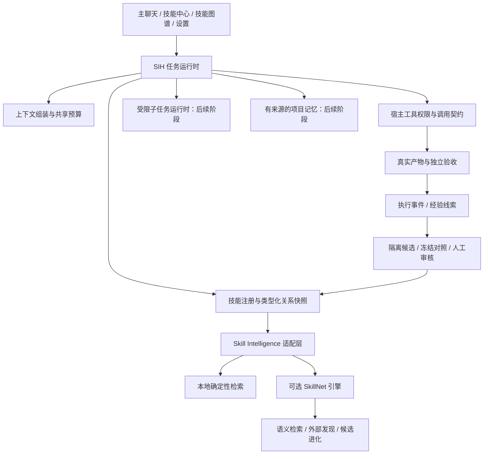

# Skillinter × SkillNet 架构与开发任务书

日期：2026-11-10。状态：阶段 A 已进入实施；实际接口、迁移和验证范围见 [阶段 A 实现说明](skill-registry.md)。其余阶段仍为设计，不代表已实现。

## 1. 目标与产品边界

以 Skillinter（SIH）为主项目，让用户给出目标、材料和权限后，系统找到适用方法、补齐缺少的能力、按真实依赖执行并验收产物；把纠正和执行经验转为隔离候选，经独立对照和人工审核后复用。逐步形成用户自己的技能网络。

SIH 负责运行、上下文、权限、预算、证据和发布。SkillNet 提供检索、关系分析、外部发现、进化算子和个人偏好方法。技能网络必须影响真实的选择和执行，且每次变化可追溯到版本、依据和用户操作。

保留当前 Node.js 24、原生 JavaScript、SQLite 主干与现有图谱界面。项目名继续使用 Skillinter。首批演示覆盖项目材料核对、代码任务和文档任务，之后按真实工具能力扩展科研与行业场景。具体比赛领域与书生模型承担的步骤另行落实，不能把模型配置等同于运行证据。

## 2. 核对依据与纠正

本次针对性阅读了本地 SIH 的运行循环、技能检索、图谱、版本发布、候选验证、模型配置、会话历史等模块，以及 SkillNet 的检索、编排、发现、进化、个人网络与导出模块。没有运行测试或模型请求。下面只说明读到的机制，不把历史 README 成绩视为本轮验证。

SIH 基线提交：`afe8a3796f9f68dd0b4629d21043fef2f2822b9a`。
SkillNet 本地 HEAD：`0af2de6a9c8b129e174e3442b67c5f7cb4324db9`。后续接入需冻结实际采用的源码与配置指纹。

SkillNet 工作区另有未提交的 `server.py`、`skillnet/jobs.py`、`web/chat.html` 改动，以及新增的 `skillnet/harness.py` 和测试文件。本次查看了新增会话存储和服务端差异：它们增加持久任务会话、提交去重与运行绑定，不能据此认定已有独立子 Agent 或 MCP。上述工作区改动未由本次修改，也不包含在 HEAD 指纹内；实施前须单独核对并冻结所需版本，避免覆盖其他工作。

外部意见中的五个 P0 不宜同时展开。先统一技能身份、关系和接入边界，再补上下文预算；接着接入 SkillNet 检索与发现、验证进化候选。多智能体是后续执行方式，MCP 是可互操作接入方式，长期记忆是独立能力，三者不应作为技能网络已生效的替代证据。

重要差异：

| 源码事实 | 影响与处理 |
| --- | --- |
| `src/skill-routing.mjs` 从静态 `web/catalog/graph.json` 读取类型化关系，按技能名关联；`src/skill-graph.mjs` 为已安装技能生成动态图，手动边存 SQLite | 两套关系来源尚未统一。图谱里的新关联不会自然进入运行编排，优先解决这一断点。 |
| SIH 的 `depend_on` 决定顺序，`compose_with` 是互补建议；SkillNet `Orchestrator.build_from_relations()` 会将二者都转成顺序边，并返回打断环的信息 | 不直接搬用编排结果。统一语义后只把确定的依赖转为硬顺序，环应阻塞或显式请求调整。 |
| SkillNet `SkillEvolver._admit()` 有 `candidate_dir` 时隔离候选，否则调用 `lib.add()` | 不能原样暴露为生产进化入口。适配层必须保证只产出提案，不能修改 SIH 正式技能或直接写入生产目录。 |
| SkillNet `adapters.py` 主要导出技能包、索引及框架示例 | 这是格式与导出能力，不能称为已经具备 MCP Server 或多智能体运行时。 |
| SkillNet `skill_discovery.discover()` 冻结公开来源、提交与许可，结果是运行级参考，并不安装 | 接入后仍须经过 SIH 的导入/候选边界，不能把发现结果直接标成已安装、可执行或已验证。 |
| SIH `Store.history()` 当前取最近 8 轮，运行循环按每条 8000 字符截取 | 已有会话持久化，但还不是按整体模型上下文预算组装的上下文管理器。 |
| SIH `settings.mjs` 在同一个当前供应商配置下列模型并选择 | 有模型选择，但没有独立多供应商注册表与任务能力路由。 |
| SkillNet `PersonalNetworkStore` 有个人配置、显式偏好和未标注观察 | 可复用其隔离与治理方法，不另建一套可独立发布正式技能的数据库。 |

## 3. 目标架构

正式技能定义与版本、项目权限、运行证据、候选晋级均由 SIH 持有。SkillNet 只持有版本化的只读索引、缓存和提案，不直接打开 SIH 数据库，不共享正式技能目录的写权限。

外部引擎输出即使格式正确，也须经宿主校验技能 ID、版本、作用范围、工具能力及适用条件。检索分只解释推荐，不能授予执行权。

## 4. 模块处置清单

| 能力 | 现有 SIH 入口 | SkillNet 参考/复用 | 决策 |
| --- | --- | --- | --- |
| 主聊天、停止、引导、事件 | `runner.mjs`、`server.mjs`、`store.mjs` | 不接第二套 pipeline | 保留并抽出共享运行服务。 |
| 文件与工具权限 | `file-scope.mjs`、`tools.mjs`、`tool-contract.mjs` | 不接第二套执行授权 | SIH 为唯一权限执行方。 |
| 正式技能与资源 | `skill-studio.mjs`、`skill-files.mjs`、`skill-libraries.mjs` | `catalog.py`、`adapters.py` | SIH 正式库为事实源，外部格式转换为适配器。 |
| 技能身份与关系 | `skill-routing.mjs`、`skill-graph.mjs`、`skill-session.mjs` | `schema.py`、`orchestrator.py`、`personal_network.py` | 新增共享注册服务，图谱与编排读同一快照。 |
| 任务检索 | `skill-routing.mjs`、`chat-skills.mjs` | `retriever.py`、`index.py`、`semantic.py` | 保留本地回退，可选引擎提供语义与图扩展建议。 |
| 外部技能发现 | 本地库扫描已实现 | `skill_discovery.py` | 新增受控发现入口，先只读预览与提案。 |
| 经验与候选 | `skill-experiences.mjs`、`skill-candidates.mjs` | `evolver.py` | 保留候选库；蒸馏、变异、组合、再生成只新增来源与算子类型。 |
| 产物与独立对照 | `skill-delivery.mjs`、`skill-execution.mjs` | 参考治理门与证据归属 | 保留 SIH 验收及审核发布，不双重发布。 |
| 上下文 | `runner.mjs`、`store.mjs` | 不依赖 Python 服务 | 新增 `context-manager.mjs`，供主任务、验证和子任务共用。 |
| 多模型 | `settings.mjs`、`apiModel()` | 不复制 SkillNet 的供应商密钥 | 新增供应商与能力注册，用户明确选择优先。 |
| 多智能体 | 当前是主 Agent 执行循环；独立对照属于试验 | `adapters.py` 不能代替运行时 | 后续新建子任务调度、隔离上下文及父子事件。 |
| 项目记忆 | 会话历史与技能经验已持久化 | `personal_network.py` | 单独维护事实/偏好/观察，避免当成同一种记忆。 |

## 5. 第一阶段：统一技能身份与类型化关系

新增 `src/skill-registry.mjs`（拟），供聊天检索、图谱、运行会话与 SkillNet 索引共同使用。

技能引用固定为 `{skillId, version, contentSha256, projectId}`。本地 UUID 为身份，名称为可变显示字段；外部来源另存 `{provider, externalId, revision}`。同名技能通过明确来源映射，不能仅按名称合并。项目覆盖全局的规则须在快照中可见。

关系包含：`id / scope / sourceId / targetId / type / provenance / revision`。

- `depend_on`：有方向，source 依赖 target；执行边为 target → source。
- `compose_with`：互补建议，本身不指定执行顺序。
- `similar_to`：替代候选，本身不自动增加执行项。
- `mention / topic / manual`：现有浏览关联，保留原语义；未经用户声明为类型化关系，不转换成硬依赖。

导入原图谱关系先保存为外部目录关系；仅当端点身份唯一解析、版本与作用范围匹配时映射到本地技能。缺依赖、歧义、失效端点、循环分别报告，不能补造节点或静默丢边后声称依赖满足。

每轮冻结 `registryRevision + skillRefs + relations + sha256`。运行中的关系编辑从下一轮生效。图谱可以显示最新关系，但必须区分“当前配置”与“本次执行快照”。

完成标准：新建两个本地技能，在页面声明 A 依赖 B；下一轮计划及执行先 B 后 A；把关系删除后新轮计划变化，旧轮回放仍保持原快照。自定义名称和同名项目覆盖都能工作。

## 6. SkillNet 接入契约（拟）

先定义与传输无关的 `SkillIntelligenceProvider`。本地实现和外部 SkillNet 实现共用参数/返回校验；采用 MCP 时再把这些操作映射到真正的 MCP 工具。普通 HTTP 或子进程 JSON 调用不能标成 MCP 已接通。

| 操作 | 输入 | 输出与边界 |
| --- | --- | --- |
| `search` | 目标、允许的技能快照、候选上限、检索模式、剩余时限 | 引用、推荐理由、通路、回退状态；允许空选。 |
| `plan` | 候选引用、类型化关系、输入产物摘要 | 提议依赖、缺少条件、冲突；宿主最终校验并采用。 |
| `discover` | 用户允许的公开能力标签、来源范围、条数/时限 | 固定提交、许可、正文指纹与来源；不直接安装。 |
| `propose` | 来源事件引用、冻结的父版本、纠正、算子 | 草案、差异、父版本与来源；只写 SIH 隔离候选。 |

应用结果统一 `{ok,data,error:{code,message}}`；协议错误与工具业务错误分别记录。错误覆盖服务不可用、超时、中断、契约不符、快照过期、引用未知、超预算及来源不合规。保留调用 ID、请求/响应摘要指纹、耗时、真实服务版本和检索降级原因。

原始材料默认留在 SIH。向外部发现服务只发送经用户授权的公开能力信息；引擎只拿到所需技能与目标片段。引擎建议额外 LLM 调用时由 SIH 的模型代理执行并计入共享预算，不把供应商密钥交给 SkillNet，也不允许算子绕开额度自行请求。

MCP 第一版优先本机受管进程：配置启动命令、握手和工具发现、调用校验、停止/超时与进程退出处理。具体协议版本和 SDK 在实施时按官方文档冻结。界面显示“未连接/已连接/失败”，连通并实际调用后才标为可用。默认启动仍只需 SIH 一条命令、一个用户入口端口，扩展引擎按需启动与回收。

## 7. 上下文与模型职责

上下文管理先于多智能体。按模型配置的上下文容量，保留输出余量；优先保留当前目标、权限、最新引导、计划、技能快照及关键回执。历史使用有来源的结构化摘要，文件与大工具结果分段读取。无法准确分词时显示估算方法并留余量；不能把字符数精确宣称为 token 数。

阶段 B 必须建立根任务统一预算账本。`context-manager.mjs` 组装上下文，配套 `run-budget.mjs` 统一负责资源预留、结算与拒绝；主会话、SkillNet 内部模型请求、供应商重试和子任务引用同一个 rootRunId。账本逐次记录调用数、工具次数、估算输入、实际输入/输出用量、超时占用、重试和取消；用量缺失保留未知与预留额，不能当作零成本。并发请求须先原子预留再发出，失败与中断不自动返还已产生的费用。事件可重建额度，重启不自动重发付费调用。此账本在阶段 B 实施，本阶段不新增另一套额度控制。

摘要包含来源事件范围和指纹，能回到原记录。摘要生成失败使用可见的截断回退，不能丢掉用户最新要求或权限限制。图片上下文成本单独考虑。

多供应商注册保留供应商 ID、端点、密钥引用、模型 ID、输入模态、工具调用、结构化输出和思考参数支持状态；未知能力保持未知。初版按用户明确选择或静态角色配置分配，动态路由需后续对照证据。中途切换供应商须记录；对照验证中发生模型变化则本次对照不能直接用于晋级。

## 8. 子任务协作（后续阶段）

先实现一个可调度的通用 Worker，再按任务启用分析与检查角色。主 Agent 负责目标与最终合并，Worker 产生证据、建议或明确产物。不同角色必须有独立模型调用、上下文和生命周期，只改 system prompt 并串行塞进同一历史不算独立协作。

子任务契约：`id / parentRunId / goal / inputs / allowedTools / fileScope / skillSnapshot / modelRef / budget / acceptance`。
返回：`status / artifacts / evidenceRefs / blockers / usage / summary`。记录简短决策依据、动作和观测，不要求输出模型隐藏思维链。

子权限为父任务权限与角色限制的交集；所有子任务计入根任务调用、耗时和并发预算。停止父任务会传播到子任务与待确认操作。初版子任务只读，产物写入独立目录，由父任务验收后合并，避免并发覆盖项目文件。重启保留中断状态，不自动重新发送付费请求。

完成标准：子任务确实独立读取各自输入；一个失败时另一个的证据仍保留；主任务给出失败处置；停止父任务结束所有子调用；单 Agent 与协作模式在同目标上可对照成本和结果。

## 9. 记忆与进化的边界

三类信息分别保存：用户确认的偏好、带文件/事件来源的项目事实、尚未判定的执行观察。技能仍是版本化可执行方法。检索到的记忆是数据，不能授予工具权限、改变验收或自动升级成系统指令。

先做项目范围的新增、检索、编辑、停用和删除，默认不跨项目共享。每条记忆记录来源、作用范围、确认状态与更新时间。事实引用的文件变化时提示失效或重新核验。跨项目记忆只在用户明确选择全局范围时启用。

进化先接“纠正 → 蒸馏/变异提案 → SIH 候选”，再考虑组合与再生成。所有算子强制候选模式。发布复用现有冻结、回归、真实产物检查与审核入口。发布技能不自动调整检索排序；排序候选另有冻结对照及回滚记录。用户偏好、一次成功、检索分、已验证产物和跨任务收益不能互相替代。

## 10. 持久化设计（拟，增量迁移）

| 表/快照 | 作用 |
| --- | --- |
| `skill_external_refs` | 本地技能 UUID 与外部 provider/ID/revision 的映射。 |
| `skill_typed_relations` | 有范围、有类型、有来源的关系；保留现有浏览关联表。 |
| `skill_registry_snapshots` | 每轮采用的技能版本、关系与摘要指纹；历史不回写。 |
| `engine_calls` | 引擎调用、状态、耗时、降级与可脱敏重放数据。 |
| `context_snapshots` | 来源范围、摘要、预算估算和省略情况。 |
| `model_providers / model_capabilities` | 供应商密钥引用和模型能力声明，不复制明文凭据。 |
| `run_children` | 父子关系、子任务配置、状态与共享预算归属。 |
| `project_memories / memory_sources` | 作用范围、确认状态、事实内容与来源。 |

已有技能、候选、经验、验收及事件表继续复用。新候选增加算子和来源引用即可，避免建立另一套正式库。迁移前备份；缺外部引擎时保留本地路径；历史记录不因升级重新评分。

## 11. 页面及可操作行为

| 页面 | 增量功能 | 必须实际产生的结果 |
| --- | --- | --- |
| 主聊天 | 推荐依据、缺少能力、子任务状态与引擎降级 | 能启动、停止、引导、查看真实回执与产物。 |
| 技能图谱 | 声明关系类型、查看关系来源/版本、切换当前配置与运行快照 | 保存关系会影响下一轮的候选链或明确报告冲突。保留现有球体与限量绘制。 |
| 技能中心 | 外部发现预览、许可/提交/资源信息、导入缺少项 | 预览、选择、导入与冲突处理有真实持久结果。 |
| 候选改进 / 经验 | 算子选择、父版本差异、独立对照 | 新候选隔离保存，失败/平局保留原版本，通过后人工审核。 |
| 项目设置或项目抽屉 | 项目记忆与来源 | 可检索、确认、编辑、停用和删除。 |
| 设置 | 引擎连接、供应商、模型能力、根任务预算 | 连接检测与保存真实生效，失败可定位；密钥不显示在回执中。 |

第一阶段只增加现有页面的必要操作；子任务初版放在回复的任务卡片里，不为尚无机制的概念新建空页面。

## 12. 开发顺序与验收

| 阶段 | 交付 | 进入下一阶段的条件 |
| --- | --- | --- |
| A | 技能身份/类型化关系注册服务、动态图谱与运行同源、历史快照 | 自定义技能关系真实改变新任务执行，旧任务可查原快照；循环与歧义明确阻塞。 |
| B | 上下文整体预算与模型代理、Skill Intelligence 适配契约 | 长任务和大回执受整体预算限制；中止贯穿适配调用；错误/回退可见。 |
| C | SkillNet 检索与外部发现、可选 MCP 接入 | 同一真实任务经过 SIH→引擎→宿主校验→执行回执；缺引擎仍能本地工作。 |
| D | 蒸馏/变异候选与现有验证、个人偏好 | 不写正式库；证据不足不能晋级；审核发布可追踪与恢复版本。 |
| E | 受限 Worker、父子预算及项目记忆 | 权限不扩张、停止传播、证据不串任务；记忆来源可查且项目隔离。 |
| F | 按实际需求接科研文档/解析工具、更多角色及路由 | 新工具有契约与验收，功能收益有独立对照，不只新增菜单。 |

前三个可演示场景：

1. 新增“梳理项目结构”和“核对交付材料”两个技能及依赖；自然语言发起任务，展示真实文件读取、依赖顺序、检查产物和图谱高亮。
2. 本地没有目标能力，系统报告缺口，用户允许公开发现；查看固定来源与资源后导入，下一轮在同一入口真正采用。来源不可用时明确返回缺口。
3. 一次任务失败后用户给出纠正；经验生成候选，原版与候选在独立任务上对照，展示一次无改进不发布，再展示有证据的审核发布及下一轮版本记录。

分别统计任务正确完成数、误选/漏选与拒绝、依赖违反次数、证据覆盖、额外调用/时延/成本、候选新增通过及回退、记忆错误命中。数据来自执行记录，不提前承诺成功率。协作、语义检索或自动路由的收益必须分别对照，不能用“功能已接通”代替“质量更好”。

阶段 A 的技能身份与执行关系见 [技能注册表](skill-registry.md)。阶段 B 的根预算、上下文与本地检索适配见 [根任务预算与上下文](run-budget.md)。下一阶段接入 SkillNet 检索与公开发现，复用阶段 B 的校验、取消和预算接口。
